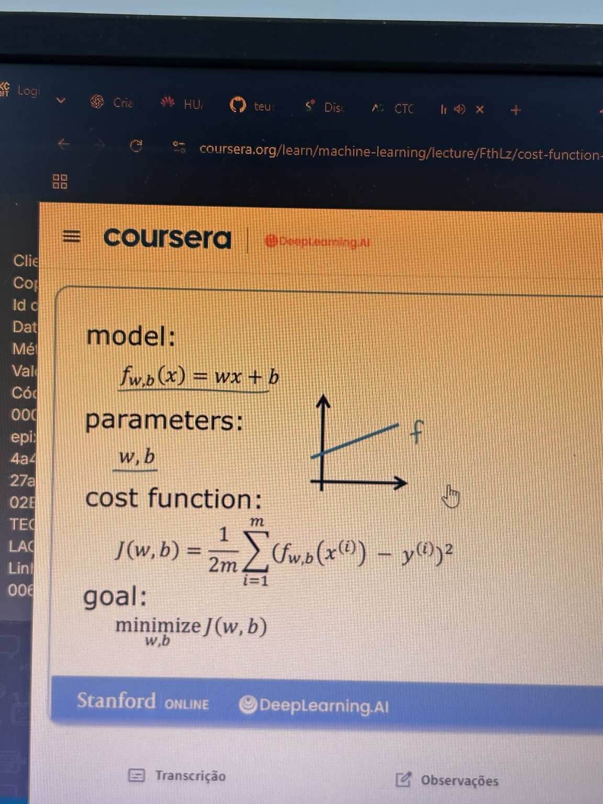
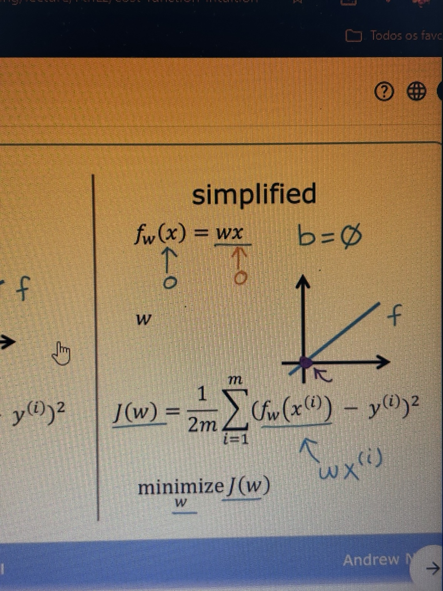
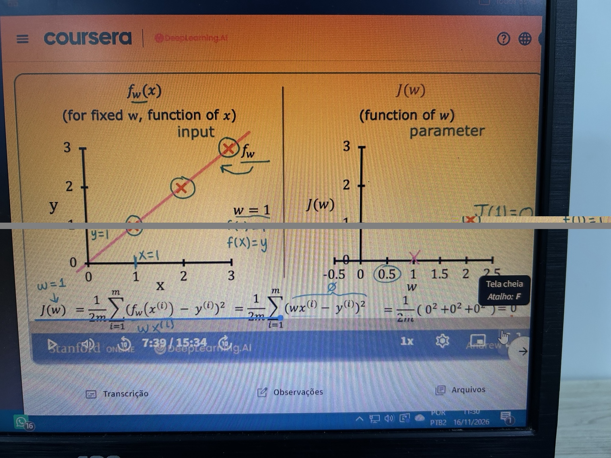
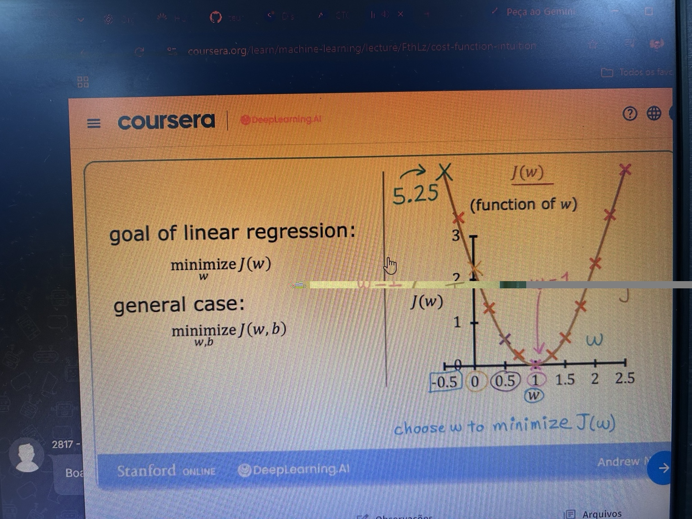

# Aula — Função de custo na regressão linear

**Curso:** *Machine Learning Specialization*, de Andrew Ng (Stanford Online / DeepLearning.AI, no Coursera)  
**Assunto:** *Cost Function* e *Cost Function Intuition*  
**Material:** 9 fotos da aula, explicação em português e um [exemplo executável em Python](exemplo_funcao_custo.py).

> Este guia é um conjunto de **anotações de estudo** baseadas nas fotos enviadas. Não é uma transcrição oficial. As imagens são registros das aulas do Coursera e pertencem aos respectivos autores.

## O que você vai entender

1. O que significam `x`, `y`, `w`, `b`, `m` e `i`.
2. O que a reta $f_{w,b}(x)=wx+b$ prevê.
3. Por que o professor simplifica a equação para $f_w(x)=wx$.
4. Como calcular **o erro entre a previsão e o valor real**.
5. O que a fórmula $J(w)$ representa e como calcular cada parte.
6. Por que o gráfico da função de custo tem formato de **parábola**.
7. O que significa **minimizar a função de custo**.

Se você leu o [Lab 02 — Representação do Modelo](../lab-02-representacao-modelo/README.md), esta aula é uma continuação natural: lá você escolheu `w` e `b` para montar uma reta; aqui aprenderá **como medir se uma escolha foi boa ou ruim**.

---

## 1. Foto inicial: o modelo, os parâmetros e o objetivo



A primeira imagem apresenta três ideias que aparecem o tempo inteiro em aprendizado de máquina.

### 1.1 Modelo de previsão

$$\boxed{f_{w,b}(x)=wx+b}$$

É uma equação de reta. Ela recebe um número `x` e devolve uma previsão.

| Símbolo | Nome | O que significa na prática |
| --- | --- | --- |
| $x$ | Entrada (*feature*) | Dado que você fornece ao modelo: por exemplo, tamanho de uma casa. |
| $f_{w,b}(x)$ | Predição | Resultado que o modelo calcula: por exemplo, o preço previsto. |
| $w$ | Peso (*weight*) | Inclinação da reta: quanto a previsão varia quando `x` aumenta 1 unidade. |
| $b$ | Viés (*bias*) | Valor inicial da reta no eixo vertical, quando `x=0`. |
| $y$ | Valor real (*target*) | Resposta correta observada no conjunto de dados. |

**Exemplo:** se $w=2$, $b=1$ e $x=3$:

$$f_{2,1}(3)=2\times3+1=7$$

A previsão é `7`. Se o valor real `y` era `8`, nosso modelo errou por `7 - 8 = -1` (um abaixo do real).

### 1.2 Parâmetros do modelo: `w` e `b`

Os parâmetros são os valores que queremos **ajustar** para a reta se aproximar dos dados reais:

- Aumentar `w` deixa a reta mais inclinada para cima, se `w` for positivo.
- Diminuir `w` reduz a inclinação; valores negativos fazem a reta descer da esquerda para a direita.
- Alterar `b` move a reta para cima ou para baixo sem mudar sua inclinação.

**Ponto-chave:** os dados `x` e `y` são os exemplos conhecidos; `w` e `b` são os números que podemos alterar para melhorar o modelo.

### 1.3 Função de custo: medir a qualidade da reta

$$\boxed{J(w,b)=\frac{1}{2m}\sum_{i=1}^{m}\left(f_{w,b}(x^{(i)})-y^{(i)}\right)^2}$$

Essa fórmula responde: **"Quão distante as previsões da minha reta estão dos valores reais?"**

Ela soma os erros ao quadrado de todos os exemplos e divide pelo dobro da quantidade de exemplos. Em inglês, *cost* significa **custo**, mas aqui não estamos falando de dinheiro: o custo é uma **medida de erro**.

O objetivo mostrado na foto é:

$$\boxed{\min_{w,b} J(w,b)}$$

Isso se lê: **"encontrar valores de `w` e `b` que deixem o custo o menor possível"**.

## 2. O que significa cada parte da fórmula de custo?

Vamos desmontá-la, símbolo por símbolo:

| Parte | Explicação |
| --- | --- |
| $J$ | Nome dado à função que mede o erro total do modelo. |
| $J(w,b)$ | O custo **depende dos parâmetros escolhidos**. Mudar `w` ou `b` pode mudar o erro. |
| $m$ | Quantidade de exemplos de treinamento. Se existem 3 pares `(x, y)`, então `m=3`. |
| $i$ | Índice do exemplo; na notação matemática da aula começa em `1`. |
| $\sum_{i=1}^{m}$ | Símbolo de somatório (sigma): somar uma parcela para cada exemplo do primeiro até o último. |
| $x^{(i)}$ | Entrada do exemplo número `i`. O `(i)` é **índice, não expoente**. |
| $f_{w,b}(x^{(i)})$ | Previsão feita pelo modelo para a entrada do exemplo `i`. |
| $y^{(i)}$ | Resultado verdadeiro do mesmo exemplo `i`. |
| $f_{w,b}(x^{(i)})-y^{(i)}$ | Erro: valor previsto menos valor real. Pode ser positivo ou negativo. |
| $(\cdots)^2$ | Eleva o erro ao quadrado, evitando cancelamento entre erros positivos e negativos e penalizando mais erros grandes. |
| $\frac{1}{2m}$ | Divide pelo número de exemplos e também por `2`. Esse `1/2` é uma convenção útil para simplificar derivadas mais adiante. |

**Por que elevar ao quadrado?** Imagine erros `+5` e `-5`. Somados diretamente dariam `0`, sugerindo que o modelo foi perfeito, embora ele tenha errado duas vezes. Elevando ao quadrado, obtemos `25 + 25 = 50`, e o erro fica visível.

**Diferença para o erro quadrático médio (MSE):** o MSE usual divide a soma por `m`. A função desta aula divide por `2m`; portanto, é **metade do MSE**. Essa constante não muda quais parâmetros minimizam a função.

## 3. Simplificando: por que aparece `b = 0`?

As fotos seguintes mostram a passagem do caso completo para um caso mais fácil de visualizar:



O professor fixa **`b = 0`** temporariamente. Isso transforma:

$$f_{w,b}(x)=wx+b \quad\longrightarrow\quad \boxed{f_w(x)=wx}$$

Como a reta agora não tem deslocamento vertical, ela **passa pela origem `(0, 0)`**. Só precisamos escolher `w`, isto é, sua inclinação.

Consequentemente, a função de custo fica:

$$\boxed{J(w)=\frac{1}{2m}\sum_{i=1}^{m}\left(wx^{(i)}-y^{(i)}\right)^2}$$

Observe duas mudanças:

1. Antes escrevíamos `J(w,b)`. Agora escrevemos `J(w)`, porque `b` deixou de variar.
2. Dentro do somatório, `f_w(x^(i))` é exatamente `w * x^(i)`.

Nas fotos há uma anotação manuscrita parecida com `b = Ø`. Neste contexto, a interpretação matemática correta é **`b = 0` (zero)**, não "conjunto vazio".

Essas fotos registram a simplificação sendo construída na aula: [IMG_5353](fotos/IMG_5353.jpeg), [IMG_5355](fotos/IMG_5355.jpeg) e [IMG_5356](fotos/IMG_5356.jpeg).

## 4. Entendendo os dois gráficos da aula

A partir daqui, o professor usa **outro conjunto de dados**, diferente do laboratório de preços das casas.

| Exemplo | Entrada $x$ | Valor real $y$ |
| --- | ---: | ---: |
| 1 | 1 | 1 |
| 2 | 2 | 2 |
| 3 | 3 | 3 |

Logo, temos $m=3$. O conjunto contém os pontos `(1,1)`, `(2,2)` e `(3,3)`.



### Gráfico da esquerda: `f_w(x)`

- Eixo horizontal: entrada **`x`**.
- Eixo vertical: previsão **`f_w(x)`** (ou `y` quando os valores coincidem).
- Cruz vermelha: **valor real** de cada exemplo.
- Reta colorida: **valores previstos** pelo modelo com um `w` escolhido.

Nesse gráfico, **fixamos `w`** e vemos como a previsão muda para diferentes valores de `x`.

### Gráfico da direita: `J(w)`

- Eixo horizontal: um **possível valor do parâmetro `w`**.
- Eixo vertical: **custo calculado** para aquele valor de `w`.
- Cada ponto indica um par `(w, custo)`.

**Cuidado para não confundir:** o gráfico da esquerda mostra a **previsão em função da entrada**. O da direita mostra **o erro em função do parâmetro**. Eles não são dois desenhos da mesma coisa.

## 5. Primeiro exemplo: escolhendo `w = 1`

Na foto acima, a reta tem inclinação `w = 1`, portanto:

$$f_1(x)=1\times x=x$$

| Entrada | Valor real | Previsão | Erro | Erro² |
| ---: | ---: | ---: | ---: | ---: |
| 1 | 1 | 1 | 0 | 0 |
| 2 | 2 | 2 | 0 | 0 |
| 3 | 3 | 3 | 0 | 0 |

Calculamos:

$$J(1)=\frac{1}{2\times3}(0^2+0^2+0^2)=\frac{0}{6}=\boxed{0}$$

**Interpretação:** com `w = 1`, a reta passa exatamente pelos três pontos reais. O erro total é zero, então o gráfico da direita marca o ponto `(1,0)`.

## 6. Segundo exemplo: escolhendo `w = 0,5`


Agora a reta fica **menos inclinada**:

$$f_{0,5}(x)=0,5x$$

| Entrada `x` | Valor real `y` | Previsão `0,5*x` | Erro `previsão − real` | Erro² |
| ---: | ---: | ---: | ---: | ---: |
| 1 | 1 | 0,5 | −0,5 | 0,25 |
| 2 | 2 | 1,0 | −1,0 | 1,00 |
| 3 | 3 | 1,5 | −1,5 | 2,25 |

**Passo 1 — somar os erros ao quadrado:**

$$0,25+1+2,25=3,5$$

**Passo 2 — dividir por `2m` (aqui, `2 * 3 = 6`):**

$$J(0,5)=\frac{3,5}{6}=\boxed{0,5833\ldots}$$

É por isso que o professor marca, no gráfico da direita, aproximadamente o ponto **`(w = 0,5; J = 0,58)`**.

**Interpretação:** a reta de `w=0,5` ainda prevê valores, mas agora passa abaixo dos valores reais e tem custo maior que zero.

## 7. Terceiro exemplo: escolhendo `w = 0`


Quando `w=0`, a previsão é sempre zero:

$$f_0(x)=0\times x=0$$

Os valores verdadeiros continuam sendo `1`, `2`, `3`.

| Entrada | Valor real | Previsão | Erro | Erro² |
| ---: | ---: | ---: | ---: | ---: |
| 1 | 1 | 0 | −1 | 1 |
| 2 | 2 | 0 | −2 | 4 |
| 3 | 3 | 0 | −3 | 9 |

Somando e dividindo:

$$J(0)=\frac{1+4+9}{2\times3}=\frac{14}{6}=\boxed{2,3333\ldots}$$

Assim, a escolha `w = 0` produz custo aproximado de **`2,33`**, maior que o custo obtido com `w = 0,5`.

Também aparece na foto a escolha `w = -0,5`. Nesse caso:

$$J(-0,5)=\frac{(-0,5-1)^2+(-1-2)^2+(-1,5-3)^2}{6}$$

$$J(-0,5)=\frac{2,25+9+20,25}{6}=\frac{31,5}{6}=\boxed{5,25}$$

O número **`5,25`** escrito acima do gráfico corresponde justamente a essa escolha: uma inclinação negativa que gera previsões bem distantes dos valores reais.

## 8. De onde surge a parábola da função de custo?

Temos os pares `(1,1)`, `(2,2)` e `(3,3)` e estamos usando `b=0`. Substituímos cada par diretamente na fórmula:

$$J(w)=\frac{1}{6}\left[(w\cdot1-1)^2+(w\cdot2-2)^2+(w\cdot3-3)^2\right]$$

Retirando o fator comum `(w−1)` de cada termo:

$$J(w)=\frac{1}{6}\left[(w-1)^2+4(w-1)^2+9(w-1)^2\right]$$

Somando `1 + 4 + 9 = 14`:

$$\boxed{J(w)=\frac{14}{6}(w-1)^2=\frac{7}{3}(w-1)^2}$$

Essa é uma **função quadrática em `w`**: o termo `(w−1)²` faz o gráfico ter formato de **U**, chamado de parábola.

| Escolha de `w` | Custo `J(w)` | É uma boa escolha? |
| ---: | ---: | --- |
| −0,5 | 5,25 | Ruim: erro grande. |
| 0 | 2,3333 | Ainda ruim. |
| 0,5 | 0,5833 | Melhorou. |
| **1** | **0** | **Melhor possível neste exemplo.** |
| 1,5 | 0,5833 | O erro volta a aumentar. |
| 2 | 2,3333 | Erro maior outra vez. |

Você pode ver que se aproximar de `w = 1` reduz o custo, mas passar desse ponto volta a aumentá-lo. **Neste conjunto de dados**, o mínimo está em `w = 1` e `J(1)=0`.

> Não significa que `w = 1` será sempre o melhor peso em qualquer problema. Ele é o melhor **para estes três pares e para este modelo simplificado**.

## 9. O que significa minimizar `J(w)`?



O objetivo da regressão linear é escolher os parâmetros que façam **as previsões se aproximarem dos valores reais**.

No exemplo simplificado, escrevemos:

$$\min_w J(w)$$

Ou seja: experimentar valores de `w` e escolher aquele que leva ao **menor erro**.

No problema completo, quando `w` **e** `b` podem variar, escrevemos:

$$\min_{w,b}J(w,b)$$

Essa diferença é essencial: fixar `b=0` facilita o desenho, mas **o modelo completo normalmente ajusta os dois parâmetros**.

Na aula das fotos, o professor mostra *por que* queremos minimizar o custo. Em aulas posteriores, você aprenderá maneiras de **encontrar automaticamente** os valores que o minimizam, como o gradiente descendente (*gradient descent*).

## 10. Exemplo em Python: calcular os custos e desenhar os gráficos

No arquivo [`exemplo_funcao_custo.py`](exemplo_funcao_custo.py), você encontra o código completo comentado em português. Ele usa **os mesmos três pares da aula** e imprime os resultados.

Para executar, instale as bibliotecas e rode:

```bash
python -m pip install numpy matplotlib
python exemplo_funcao_custo.py
```

### O que o código faz, passo a passo

1. `np.array([1., 2., 3.])` cria os arrays de entradas e respostas reais.
2. `prever(x, w)` implementa a reta $f_w(x)=wx$.
3. `calcular_custo(x, y, w)` calcula os erros, eleva cada um ao quadrado, soma e divide por `2*m`.
4. Um `for` calcula o custo para `w = -0.5`, `0`, `0.5`, `1`, `1.5` e `2`.
5. `np.linspace(-0.5, 2.5, 150)` cria 150 valores de `w` igualmente espaçados para desenhar a parábola.
6. `plt.scatter` desenha os valores reais; `plt.plot` desenha a reta e a curva de custo.
7. `plt.show()` abre a figura com **os dois gráficos lado a lado**, como na aula.

### Relação com o notebook anterior

| Lab 02: representação do modelo | Esta aula: função de custo |
| --- | --- |
| Pergunta: "como a reta faz uma previsão?" | Pergunta: "o quanto a previsão errou?" |
| Usa casas de 1.000 e 2.000 sqft, com preços de US$ 300 mil e US$ 500 mil. | Usa três pontos ilustrativos: `(1,1)`, `(2,2)` e `(3,3)`. |
| Trabalha com $f_{w,b}(x)=wx+b$, escolhendo `w` e `b` manualmente. | Para explicar os gráficos, fixa `b=0` e testa vários valores de `w`. |
| Resultado: preço previsto para uma casa nova. | Resultado: valor do custo e localização do mínimo. |

## 11. Perguntas para revisar

1. Qual a diferença entre `y` e `f_w(x)`?
2. Se a previsão foi `5` e o valor real foi `7`, qual o erro e qual seu quadrado?
3. Por que dividimos a soma dos erros por `m`?
4. Por que a aula usa `b=0` temporariamente?
5. No exemplo dos três pontos, por que `w=1` é melhor que `w=0,5`?
6. No gráfico da direita, o eixo horizontal representa o dado de entrada `x` ou o peso `w`?
7. Se `J(w)` está aumentando quando você aumenta `w`, isso significa necessariamente que o custo continuará aumentando se você diminuir `w`? (Pense no formato de U.)

**Respostas para conferir:** (1) `y` é o valor verdadeiro; `f_w(x)` é a previsão. (2) Erro `−2`, quadrado `4`. (3) Para considerar a quantidade de exemplos ao comparar o erro médio. (4) Para variar apenas `w` e facilitar o entendimento. (5) Porque com `w=1` todas as previsões são iguais aos valores reais, com custo `0`. (6) Representa `w`. (7) Não necessariamente; depende de qual lado do mínimo você está.

---

## 12. Índice das nove fotos da aula

| Arquivo | Conteúdo mostrado |
| --- | --- |
| [IMG_5351.jpeg](fotos/IMG_5351.jpeg) | Modelo completo `wx+b`, custo `J(w,b)` e objetivo. |
| [IMG_5353.jpeg](fotos/IMG_5353.jpeg) | Início da simplificação com `b=0` e `f_w(x)=wx`. |
| [IMG_5355.jpeg](fotos/IMG_5355.jpeg) | Fórmula simplificada de custo e minimização de `J(w)`. |
| [IMG_5356.jpeg](fotos/IMG_5356.jpeg) | A reta passa pela origem quando `b=0`. |
| [IMG_5357.jpeg](fotos/IMG_5357.jpeg) | Explicação dos elementos de `f_w(x)` e da fórmula do custo. |
| [IMG_5359.jpeg](fotos/IMG_5359.jpeg) | Exemplo com `w=1`, custo `J(1)=0`, e os dois gráficos. |
| [IMG_5361.jpeg](fotos/IMG_5361.jpeg) | Exemplo com `w=0,5` e custo aproximado de `0,58`. |
| [IMG_5362.jpeg](fotos/IMG_5362.jpeg) | Exemplo com `w=0`, custo aproximado `2,33`, e parábola `J(w)`. |
| [IMG_5364.jpeg](fotos/IMG_5364.jpeg) | Objetivo: minimizar `J(w)` ou, no caso geral, `J(w,b)`. |

As fotos foram mantidas como enviadas; algumas mostram etapas sucessivas da **mesma explicação**. Clique nos nomes para abrir cada imagem em tamanho maior.
