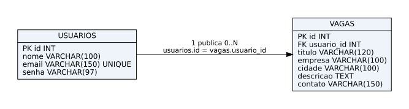

# Entenda o código — explicação para defender em sala

Leia na sequência **app.py → banco.py → vagas_api.py**. O objetivo deste documento não é decorar o código, mas entender por que cada parte existe e como os dados circulam.

## 1. Primeiro: o que cada arquivo faz?

| Arquivo | Responsabilidade | Explicação simples |
|---|---|---|
| `app.py` | Interface | Exibe telas, recebe cliques e mostra resultados |
| `banco.py` | Regras + persistência | Valida dados, cria objetos, consulta e grava no MySQL |
| `vagas_api.py` | Integração externa | Consulta uma API de vagas por HTTP e interpreta o JSON |
| `.env` | Configuração local | Guarda dados de conexão e chaves da API; fica fora do GitHub |
| `sql/criar_banco.sql` | Preparação do servidor | Cria o banco `conectavagas` no Workbench |
| `requirements.txt` | Dependências | Bibliotecas para executar o app |

### Acompanhe o clique em Publicar vaga com o código aberto

1. Em `app.py`, procure a classe `TelaNovaVaga`. Na linha que contém `("Publicar vaga", self.salvar)`, a tela entrega a função ao botão. Os parênteses ficam de fora de `self.salvar` porque ela deve executar quando alguém clicar.
2. No método `salvar` dessa classe, `self.titulo_vaga.GetValue()` lê o texto digitado. Já `self.janela.usuario["id"]` vem do login. Assim o sistema sabe qual empresa é dona do anúncio.
3. Em `banco.py`, siga para `criar_vaga`. Digite mentalmente um título de duas letras: a validação lança `ValueError`. A tela captura o erro e mantém o formulário aberto para correção.
4. Para dados válidos, `sessao.get(Usuario, empresa_id)` busca a conta. Depois da verificação do tipo, `Vaga(...)` monta o objeto, `sessao.add(vaga)` o inclui na sessão e `sessao.commit()` confirma a gravação.
5. No Workbench, execute `SELECT id, empresa_id, titulo, cidade FROM conectavagas.vagas;`. Compare o título com o formulário e o `empresa_id` com o ID da empresa em `usuarios`.

## 2. Como funciona wxPython?

**wxPython** é uma biblioteca que cria aplicativos com componentes nativos de desktop. Ela não precisa de HTML, CSS ou Flask.

- `wx.App`: controla o ciclo de vida do programa.
- `wx.Frame`: é a janela principal do aplicativo.
- `wx.Panel` e `wx.ScrolledWindow`: são regiões dentro da janela. Cada classe `Tela...` representa uma tela.
- `wx.TextCtrl`: campo de texto em que o usuário digita.
- `wx.Button`: botão clicável.
- `wx.ListCtrl`: tabela visual que exibe linhas de resultados.
- `wx.BoxSizer`: organiza os componentes vertical ou horizontalmente.
- `Bind(wx.EVT_BUTTON, funcao)`: liga o clique do botão a uma função Python.

### Exemplo explicado, linha a linha

```python
botao = wx.Button(parent, label="Entrar")
# Cria um botão de interface com o texto "Entrar".

botao.Bind(wx.EVT_BUTTON, self.entrar)
# Quando o usuário clicar, wxPython vai chamar self.entrar(evento).
```

Ao clicar, a função `entrar()` é executada. Ela lê os campos, chama `banco.autenticar(...)` e decide qual tela abrir.

## 3. O que significa `self`?

Em uma classe Python, `self` representa o **objeto atual**. Em `TelaCadastro`, por exemplo, `self.email` é o campo de e-mail pertencente à tela. `self.email.GetValue()` lê o texto que o usuário digitou.

```python
self.email = self.campo("E-mail")
# Guarda o campo visual em self.email.

email_digitado = self.email.GetValue()
# Lê o valor daquele campo.
```

## 4. Como as telas mudam?

A classe `JanelaPrincipal` contém `ir(self, pagina, **dados)`:

1. Remove a tela anterior do organizador (`self.estrutura.Detach(...)`).
2. Destrói os controles da tela anterior (`Destroy()`).
3. Atualiza o menu de acordo com o tipo de usuário.
4. Cria e exibe uma nova classe `Tela...`.

Exemplo:

```python
self.janela.ir(TelaVagas)
```

Isso significa: **vá para a tela de vagas**. As telas são painéis dentro de uma mesma janela; o professor pede telas navegáveis, não que você abra várias janelas do sistema operacional.

## 5. Como funciona a autenticação?

### Em `app.py`

`TelaCadastro.salvar()` lê o formulário e chama `banco.cadastrar_usuario(...)`. `TelaLogin.entrar()` recebe o e-mail e a senha e chama `banco.autenticar(...)`.

### Em `banco.py`

**`cadastrar_usuario()`**:

1. Tira espaços extras (`strip()`) e valida tamanho dos campos.
2. Confirma se a conta é do tipo `candidato` ou `empresa`.
3. Gera um valor aleatório (`salt = secrets.token_bytes(16)`).
4. Produz um hash da senha com `hashlib.pbkdf2_hmac(...)`.
5. Monta um objeto `Usuario(...)`.
6. Usa `sessao.add(usuario)` e `sessao.commit()` para salvar no MySQL.

**`autenticar()`**:

1. Pesquisa o usuário por e-mail.
2. Usa o salt que está no banco para calcular novamente o hash da senha digitada.
3. Compara com `hmac.compare_digest()`.
4. Retorna os dados do usuário se estiver correto, ou `None` se estiver incorreto.

**Por que não guardar senha normal?** Porque quem consultar o banco não deve enxergar a senha original.

## 6. O que é SQLAlchemy? O que é PyMySQL?

**SQLAlchemy** permite representar uma tabela como uma classe Python. O **PyMySQL** é o driver que conversa com o servidor MySQL usando o protocolo do banco.

```python
class Usuario(Base):
    __tablename__ = "usuarios"
    id: Mapped[int] = mapped_column(primary_key=True)
```

- `class Usuario(Base)`: define um modelo de dados.
- `__tablename__ = "usuarios"`: informa qual tabela SQL essa classe representa.
- `Mapped[int]`: diz que o campo é numérico.
- `mapped_column(primary_key=True)`: define a chave primária, que identifica cada linha.

**`Base.metadata.create_all(engine)`**: SQLAlchemy cria as tabelas que ainda não existem, usando o banco `conectavagas` previamente criado no Workbench.

**`with sessao_banco() as sessao`**: abre a sessão para consultar/gravar e fecha ao terminar. **`commit()`** confirma a transação no banco; **`rollback()`** desfaz uma transação com falha.

### Exemplo de consulta no ORM

```python
usuario = sessao.scalar(select(Usuario).where(Usuario.email == email))
```

Traduzindo: *encontre um registro da tabela usuários cujo e-mail seja igual ao informado*. O SQLAlchemy envia uma consulta parametrizada ao banco, evitando que seja necessário montar SQL com concatenação de texto digitado pelo usuário.

## 7. Como as três tabelas se relacionam?



**PK** significa chave primária (identificador único de uma linha). **FK** significa chave estrangeira (uma coluna que aponta para o ID de outra tabela).

- `usuarios.id`: ID do candidato ou da empresa.
- `vagas.empresa_id`: aponta para `usuarios.id` da empresa que criou aquela vaga.
- `candidaturas.candidato_id`: aponta para `usuarios.id` do candidato.
- `candidaturas.vaga_id`: aponta para `vagas.id` da vaga escolhida.

**Por que não guardar nome da empresa diretamente na candidatura?** Porque a relação pelo ID permite recuperar o dado correto da empresa e evita repetir informações desnecessárias.

## 8. Fluxo completo de publicar uma vaga

1. A empresa se cadastra (tabela `usuarios`, com `tipo='empresa'`).
2. Faz login e vai à `TelaNovaVaga`.
3. Preenche título, área, descrição, requisitos, cidade, modalidade, contrato e remuneração.
4. `TelaNovaVaga.salvar()` chama `banco.criar_vaga(...)`.
5. `criar_vaga()` confere os dados e garante que o usuário realmente tem tipo `empresa`.
6. O SQLAlchemy insere a vaga na tabela `vagas` e confirma com `commit()`.
7. A tela `TelaVagas` usa `listar_vagas()` para consultar os anúncios ativos.

**Qual regra impede um candidato de publicar uma vaga?** A condição dentro de `criar_vaga()` que verifica `empresa.tipo != 'empresa'`.

## 9. Fluxo completo de candidatura (a parte mais importante)

### No wxPython

Em `TelaDetalhes.candidatar()`:

```python
banco.candidatar(self.janela.usuario["id"], self.vaga_id, self.mensagem.GetValue())
```

- `self.janela.usuario["id"]`: identifica a pessoa que está logada.
- `self.vaga_id`: identifica a vaga aberta.
- `self.mensagem.GetValue()`: lê a mensagem opcional do candidato.
- `banco.candidatar(...)`: entrega os valores à camada de dados.

### No banco.py

A função `candidatar()` faz estas verificações **antes de gravar**:

1. Verifica se o usuário existe e tem tipo `candidato`.
2. Verifica se a vaga existe e está ativa.
3. Consulta se já existe candidatura daquele usuário àquela vaga.
4. Cria o objeto `Candidatura` e salva com `commit()`.

Além da checagem Python, a tabela tem a restrição SQL:

```python
UniqueConstraint("candidato_id", "vaga_id", name="uq_candidato_vaga")
```

Isso evita que **duas linhas tenham o mesmo candidato e a mesma vaga**, inclusive se duas solicitações de cadastro acontecerem muito próximas.

### No painel da empresa

`banco.candidatos_da_vaga(empresa_id, vaga_id)` confirma que a vaga pertence à empresa logada. Só então devolve nome, e-mail, telefone e mensagem dos candidatos. A empresa pode alterar o status com `mudar_status_candidatura()`.

**Por que é importante verificar o proprietário da vaga no banco.py?** Porque não basta esconder um botão na interface: a regra de permissão deve existir na camada de dados.

## 10. Como funciona a API de vagas externas?

**API** é uma interface pela qual um sistema pode solicitar informações de outro sistema. Uma API HTTP normalmente recebe uma requisição e responde em **JSON**.

Em `vagas_api.py`:

1. `buscar_vagas_externas(termo, local)` lê `ADZUNA_APP_ID` e `ADZUNA_APP_KEY` do `.env`.
2. Monta a URL com `urlencode(...)` para escapar corretamente os parâmetros de busca.
3. Usa `urlopen(...)` para enviar uma requisição **GET HTTPS** à Adzuna.
4. Lê a resposta JSON com `json.load(...)`.
5. Chama `formatar_vaga(item)` para simplificar as informações usadas na tela.
6. Devolve uma lista de dicionários; `TelaExternas.pesquisar()` preenche o `wx.ListCtrl`.
7. Ao clicar no anúncio, `wx.LaunchDefaultBrowser(...)` abre o link original.

**Não é uma API do LinkedIn.** `url_pesquisa_linkedin()` apenas monta uma URL para pesquisar no site oficial. A busca de API foi feita com a Adzuna, porque a API de vagas do LinkedIn para integração não é aberta a qualquer projeto acadêmico.

**Por que não armazenamos vagas da API no MySQL?** Porque este protótipo evita confundir a origem dos anúncios e deixa as candidaturas externas sob responsabilidade do site que publicou a vaga. Só vagas criadas pelas empresas cadastradas entram na tabela `vagas`.

## 11. O que tem no .env?

O arquivo `.env.example` é apenas um modelo. Você cria `.env` com dados reais do seu próprio servidor:

```ini
MYSQL_HOST=127.0.0.1
MYSQL_PORT=3306
MYSQL_USER=root
MYSQL_PASSWORD=SUA_SENHA
MYSQL_DATABASE=conectavagas
```

Quando `banco.iniciar_banco()` roda, o `URL.create('mysql+pymysql', ...)` monta a conexão com o **servidor MySQL**. O Workbench acessa o mesmo banco por uma interface visual.

## 12. Perguntas prováveis do professor (respostas curtas)

**Por que wxPython?** Porque é a ferramenta de interface gráfica desktop usada na disciplina e atende à exigência de telas navegáveis.

**Por que MySQL?** Para manter usuários, vagas e candidaturas de forma persistente e relacional, mesmo depois de fechar o programa.

**Por que três tabelas?** Para separar pessoas, anúncios e inscrições, ligando-as por chaves estrangeiras.

**O que significa cardinalidade 1:N?** Que um registro pode estar associado a vários registros de outra tabela. Uma empresa pode cadastrar várias vagas.

**O que ocorre se duas pessoas se candidatarem à mesma vaga?** O banco aceita, porque são candidatos diferentes. A restrição impede apenas que **o mesmo candidato** se inscreva duas vezes na mesma vaga.

**O Workbench é o banco de dados?** Não. Ele é uma ferramenta gráfica para administrar o servidor MySQL.

**O LinkedIn foi integrado via API?** Não. A consulta programática usa Adzuna, e o botão LinkedIn abre uma busca em seu site.

**O que ocorre sem internet?** As vagas locais seguem funcionando com MySQL local; a consulta à API não funciona.

**Quais limitações?** Não há verificação de empresas, recuperação de senha, anexos de currículo ou fluxos de produção. O projeto é acadêmico.

## 13. Ordem que recomendo para estudar

1. Abra `docs/diagrama_er.svg` e explique os IDs e relacionamentos.
2. Leia `banco.py`: `Usuario`, `Vaga`, `Candidatura` e `iniciar_banco()`.
3. Leia `cadastrar_usuario()`, `autenticar()`, `criar_vaga()` e `candidatar()`.
4. Abra `app.py`: localize `TelaLogin`, `TelaNovaVaga` e `TelaDetalhes` e seus métodos `.salvar()` / `.entrar()` / `.candidatar()`.
5. Só então leia `vagas_api.py`, que é uma parte adicional do projeto.
6. Faça você mesmo o fluxo completo usando duas contas e consulte as três tabelas no Workbench.

> **Sugestão para a defesa:** em vez de decorar 700 linhas, domine profundamente o fluxo de uma candidatura e as funções que ele executa. Mostre como a tela chama o Python e como o Python grava no MySQL.
