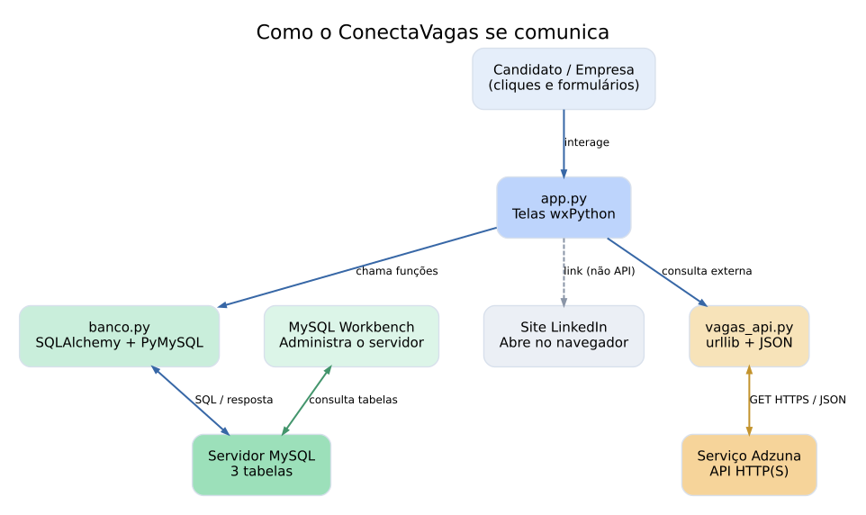
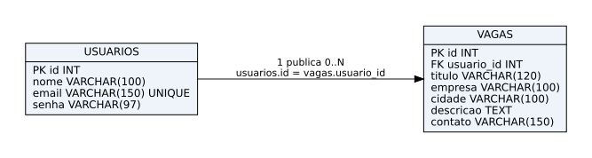

# Relatório acadêmico — ConectaVagas

## 1. Identificação e proposta

**Título:** ConectaVagas — Aplicativo de cadastro, consulta e gerenciamento de empregos e estágios em Porto Velho (RO).

**Área:** Sistemas de Informação, desenvolvimento de aplicações desktop e bancos de dados relacionais.

**Problema social:** Pessoas que buscam a primeira oportunidade ou um estágio na região podem ter dificuldade para encontrar anúncios dispersos. Empresas locais também precisam de uma forma simples de divulgar oportunidades e receber candidaturas.

**Proposta:** Desenvolver um sistema desktop com duas categorias de usuários: candidatos e empresas. Empresas divulgam vagas; candidatos podem pesquisar, candidatar-se e acompanhar resultados. Uma integração opcional com API externa amplia a consulta de vagas.

**Observação:** A definição do problema é uma motivação plausível do projeto, **não uma pesquisa estatística** de desemprego local.

## 2. Objetivos

**Objetivo geral:** Disponibilizar uma interface em wxPython com dados persistidos em MySQL, facilitando a publicação e a consulta de vagas de emprego e estágio na região.

**Objetivos específicos:**

1. Permitir cadastro e autenticação de candidatos e empresas.
2. Permitir a publicação e o encerramento de vagas por empresas.
3. Permitir consultas e filtros por título, área e cidade.
4. Permitir candidatura a vagas locais sem duplicação.
5. Permitir que a empresa acompanhe e altere a situação da candidatura.
6. Integrar consulta opcional de vagas externas por API.
7. Documentar o banco, a arquitetura e o funcionamento do sistema.

## 3. Tecnologias

**Python:** implementação da lógica de negócio. **wxPython:** interface gráfica desktop. **SQLAlchemy:** mapeamento objeto-relacional das tabelas. **PyMySQL:** driver de comunicação SQL com MySQL. **MySQL Server:** armazenamento persistente. **MySQL Workbench:** interface de administração do servidor. **Adzuna:** API HTTP/JSON usada somente na pesquisa opcional de vagas externas.

## 4. Requisitos funcionais

| Identificador | Requisito |
|---|---|
| RF01 | Cadastrar conta de candidato ou empresa |
| RF02 | Autenticar com e-mail e senha |
| RF03 | Permitir ao candidato consultar e filtrar vagas |
| RF04 | Permitir à empresa publicar vagas |
| RF05 | Permitir à empresa abrir ou encerrar vagas |
| RF06 | Permitir candidatura de candidato autenticado |
| RF07 | Impedir duplicidade de candidatura por vaga |
| RF08 | Permitir ao candidato consultar suas candidaturas |
| RF09 | Permitir à empresa consultar candidatos de suas vagas |
| RF10 | Permitir à empresa atualizar situação da candidatura |
| RF11 | Permitir atualizar telefone, cidade e apresentação do perfil |
| RF12 | Permitir consulta externa via API Adzuna quando configurada |
| RF13 | Abrir busca de vagas no LinkedIn pelo navegador, sem integração API |

## 5. Requisitos não funcionais

- Interface 100% wxPython, com mais de cinco telas.
- Persistência em banco MySQL.
- Código versionável pelo GitHub, sem `.env` e senhas públicas.
- Senhas com hash e salt, sem texto puro.
- Verificação de permissões de candidato/empresa na camada de dados.
- Mensagens amigáveis para erros de validação, duplicidade e API indisponível.

## 6. Arquitetura do sistema

O usuário interage com `app.py` (wxPython). As telas invocam funções do `banco.py`, que usa SQLAlchemy, PyMySQL e uma conexão com o servidor MySQL. O MySQL Workbench pode acessar **o mesmo servidor** para inspecionar tabelas e dados. A tela de vagas externas chama `vagas_api.py`, que envia uma requisição HTTP(S) à Adzuna e transforma a resposta JSON em uma lista; nenhum anúncio externo é salvo nas tabelas locais.

## 7. Modelo Entidade-Relacionamento

### 7.1 Entidades

**USUARIOS:** Guarda candidatos e empresas em uma única tabela. A coluna `tipo` informa o papel, e o `id` identifica cada conta. O e-mail é único. A senha é representada por `salt` e `hash_senha`, não pelo texto original.

**VAGAS:** Cada vaga possui `empresa_id` (chave estrangeira para `usuarios.id`), informações do anúncio e `ativa` para indicar se recebe candidaturas.

**CANDIDATURAS:** Representa a inscrição de um candidato em uma vaga. Possui `candidato_id` (FK `usuarios.id`) e `vaga_id` (FK `vagas.id`), além de mensagem, situação e data. A restrição composta `UNIQUE(candidato_id, vaga_id)` evita inscrições duplicadas.

### 7.2 Relacionamentos e cardinalidade

- **USUARIOS (empresa) 1:N VAGAS:** uma empresa pode anunciar várias vagas; cada vaga pertence a uma empresa.
- **USUARIOS (candidato) 1:N CANDIDATURAS:** um candidato pode realizar várias inscrições; cada candidatura pertence a um candidato.
- **VAGAS 1:N CANDIDATURAS:** uma vaga pode receber várias inscrições; cada candidatura refere-se a uma vaga.

**Regra adicional de negócio:** a aplicação usa `tipo` para exigir que o titular de `empresa_id` seja uma empresa e o titular de `candidato_id` seja um candidato. Como ambos apontam à tabela `usuarios`, essa regra é validada no Python, não apenas pelas chaves estrangeiras.

## 8. Telas do sistema

O projeto contém doze telas, implementadas como classes wxPython no `app.py`: `TelaInicio`, `TelaCadastro`, `TelaLogin`, `TelaVagas`, `TelaDetalhes`, `TelaMinhasCandidaturas`, `TelaPerfil`, `TelaEmpresa`, `TelaNovaVaga`, `TelaCandidatos`, `TelaExternas` e `TelaSobre`. A classe `JanelaPrincipal` troca a tela visível conforme a navegação.

## 9. Caso de uso principal (candidatura)

1. Uma empresa cria uma conta e faz login.
2. A empresa publica uma vaga; `criar_vaga()` grava a linha na tabela `vagas`.
3. Um candidato cria conta e faz login.
4. A busca de vagas chama `listar_vagas()`, que consulta o MySQL.
5. O candidato seleciona a vaga e envia candidatura.
6. `candidatar()` verifica papel, existência da vaga, disponibilidade e duplicidade; em seguida grava em `candidaturas`.
7. A empresa acessa os candidatos e altera o status (por exemplo, `Em análise`).
8. O candidato visualiza o status atualizado em `Minhas candidaturas`.

## 10. Integração externa

`vagas_api.py` usa a API **Adzuna** por HTTPS para retornar oportunidades conforme palavra-chave e cidade. A resposta JSON fornece título, empresa, localização, descrição e link do anúncio. A inscrição é realizada no site de origem. A quantidade de resultados depende da API e dos anúncios existentes. Não há acesso irrestrito de leitura à API de empregos do LinkedIn; o botão correspondente abre somente uma busca no navegador.

## 11. Plano de testes e resultados

Foram automatizados **11 testes** com `pytest`, cobrindo autenticação, hash de senha, e-mail duplicado, pesquisa de vagas, restrições de permissões, candidatura duplicada, abertura/fechamento de vagas, atualização de status, atualização de perfil, tratamento do JSON de API e validação de links externos. **Os 11 testes passaram em ambiente de desenvolvimento** usando SQLite temporário para as operações de ORM. A execução da interface e a conexão com um servidor MySQL real deverão ser conferidas na máquina de apresentação.

## 12. Limitações e melhorias futuras

Trata-se de uma prova de conceito. Não inclui confirmação de e-mail, redefinição de senha, autenticação multifator, verificação documental das empresas, notificações, currículo anexado ou avaliação completa de conformidade LGPD. Melhorias possíveis são filtros avançados, relatórios, painel de administração, verificação de empresas e conexão com outras fontes oficiais de vagas.

## 13. Referências técnicas

- wxPython: https://wxpython.org/
- SQLAlchemy: https://docs.sqlalchemy.org/
- MySQL Workbench: https://dev.mysql.com/doc/workbench/en/
- Adzuna Search API: https://developer.adzuna.com/docs/search
- LinkedIn Jobs API (restrições de acesso): https://learn.microsoft.com/en-us/linkedin/talent/job-postings/api/overview

## 14. Como executar

O procedimento completo encontra-se em `tutorial_de_uso.md`. Primeiro execute `sql/criar_banco.sql` no Workbench; em seguida, instale dependências Python, configure `.env` e abra `app.py`.
